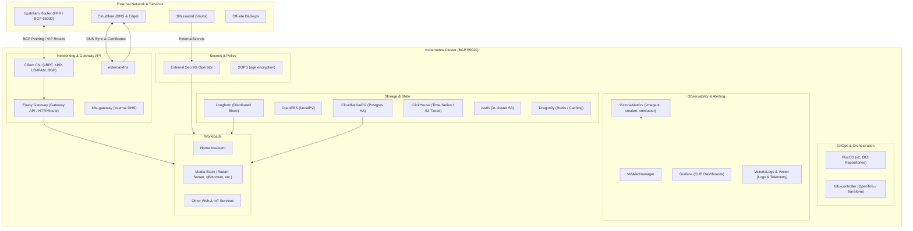

# K8s at Home

GitOps repository managing my homelab Kubernetes cluster using [FluxCD](https://fluxcd.io/).

______________________________________________________________________

## Architecture Overview



______________________________________________________________________

## Core Technologies

### Networking & Routing

- **CNI & BGP**: [Cilium](https://cilium.io/) with eBPF, `kubeProxyReplacement: true`, native BGP Control Plane peering with upstream FRR, and LoadBalancer IPAM (`CiliumLoadBalancerIPPool`).
- **Ingress & Gateway API**: [Envoy Gateway](https://gateway.envoyproxy.io/) implementing the Kubernetes Gateway API (`Gateway`, `HTTPRoute`, `SecurityPolicy`).
- **DNS**: [k8s-gateway](https://github.com/ori-edge/k8s_gateway) for internal cluster service discovery, and [external-dns](https://github.com/kubernetes-sigs/external-dns) for Cloudflare public records.
- **Certificates**: [cert-manager](https://cert-manager.io/) with Cloudflare ACME DNS-01 validation.

### GitOps & Automation

- **GitOps Engine**: [FluxCD](https://fluxcd.io/) (`Kustomization`, `HelmRelease`, `OCIRepository`).
- **Infrastructure as Code**: [tofu-controller](https://github.com/flux-iac/tofu-controller) managing OpenTofu/Terraform infrastructure modules (e.g. S3 buckets, cloud configs).
- **Automated Updates**: [Renovate](https://github.com/renovatebot/renovate) with custom regex managers and automated digest pinning.

### Secrets Management

- **Primary (Runtime Secrets)**: [External Secrets Operator](https://external-secrets.io/) fetching secrets directly from **1Password** via the 1Password SDK / Connect `ClusterSecretStore`.
- **Bootstrap Secrets**: [SOPS](https://github.com/getsops/sops) with `age` encryption for cluster bootstrap tokens (1Password credentials, Flux webhooks).

### Storage & Databases

- **Block Storage**: [Longhorn](https://longhorn.io/) distributed block storage with snapshotting, and [OpenEBS](https://openebs.io/) LocalPV for high-performance node-local data.
- **PVC Backups**: [Kopiur](https://github.com/home-operations/kopiur) with CSI `snapshot-controller` backing up stateful Longhorn PVCs to the NAS over SMB (`components/kopiur/`).
- **Databases**: [CloudNativePG](https://cloudnative-pg.io/) managing high-availability PostgreSQL clusters with Barman Cloud backups to S3.
- **Time-Series / Analytics**: [ClickHouse](https://clickhouse.com/) with Longhorn hot storage, tiered S3 offloading to `rustfs`, and [CH-UI](https://github.com/caioricciuti/ch-ui) for ad-hoc querying.
- **Object Storage**: [rustfs](https://github.com/rustfs) S3-compatible in-cluster object storage.
- **Key-Value Store**: [Dragonfly](https://dragonflydb.io/) Operator high-performance Redis-compatible cache.

### Observability & Alerting

- **Metrics**: [VictoriaMetrics](https://victoriametrics.com/) Operator (`vmcluster`, `vmalert`, `vmagent`) scraping targets via `PodMonitor` and evaluating `PrometheusRule` manifests.
- **Alerting**: [VMAlertmanager](https://docs.victoriametrics.com/operator/design/#vmalertmanager) (VictoriaMetrics Operator managed Alertmanager).
- **Logging & Telemetry**: [VictoriaLogs](https://victoriametrics.com/products/victorialogs/) and [Vector](https://vector.dev/) routing cluster logs to VictoriaLogs and Telegraf/IoT telemetry to ClickHouse.
- **Dashboards**: Grafana dashboards generated via **CUE** (`cue/grafana/`).

______________________________________________________________________

## Repository Structure

The deployment flow is defined by the top-level Flux `Kustomization` manifests:

```
├── repos/          # Helm repository & OCI source definitions
├── crds/           # Custom Resource Definitions & CRD controllers
├── system/         # Core infrastructure (Cilium, Envoy Gateway, Storage, Cert-Manager)
├── monitoring/     # Observability stack (VictoriaMetrics, VictoriaLogs, Grafana, Alerting Rules, Vector)
├── backends/       # Foundational shared services (DNS, Authelia, ClickHouse, LDAP, MQTT, RustFS)
├── media/          # Media stack (Radarr, Sonarr, Prowlarr, SABnzbd, qBittorrent, Transcoder)
├── apps/           # User-facing applications (Homepage, Zigbee2MQTT, Web & IoT services)
├── cue/
│   └── grafana/    # Shared CUE library for typed Grafana dashboards
```

______________________________________________________________________

## Development & Operations

### Local Development Environment (`nix` & `direnv`)

This repository uses [Nix Flakes](https://nixos.org/) and `direnv` (`flake.nix`). Entering the repository directory automatically loads all necessary tooling:

```bash
# Enter nix development shell manually (if not using direnv)
nix develop
```

### Code Formatting (`nix fmt` / `treefmt`)

Code formatting is enforced across Markdown, YAML, and Nix via `treefmt`:

```bash
nix fmt
```

### Grafana Dashboards (CUE)

Dashboards across the repository are authored in **[CUE](https://cuelang.org/)** using shared definitions in `cue/grafana/`.

```bash
# Compile all dashboards in the repo to JSON
nix develop --command build-dashboards .

# Run unit tests and schema constraint validation
nix develop --command cue vet -c ./cue/grafana/
```

### OPA Policy Testing & Linting

Transcoder policy rules use Open Policy Agent (Rego):

```bash
# Run OPA tests
nix develop --command opa test media/transcoder/policy/ -v

# Run Regal linter
nix develop --command regal lint media/transcoder/policy
```

### Validation Suite (`nix flake check`)

Run the full repository validation suite (formatting, CUE dashboard checks, Vector config validation, OPA/Regal tests, and Renovate config) locally:

```bash
nix flake check -L
```

### GitOps Workflow Rules

All cluster changes are managed strictly via GitOps (FluxCD):

- **No manual mutation**: Never run imperative `kubectl apply`, `kubectl delete`, or `helm install`.
- **Validation before commit**: Format with `nix fmt` and verify manifests render cleanly with `kustomize build`.
- **Review before push**: Git pushes trigger automatic cluster synchronization once merged.
