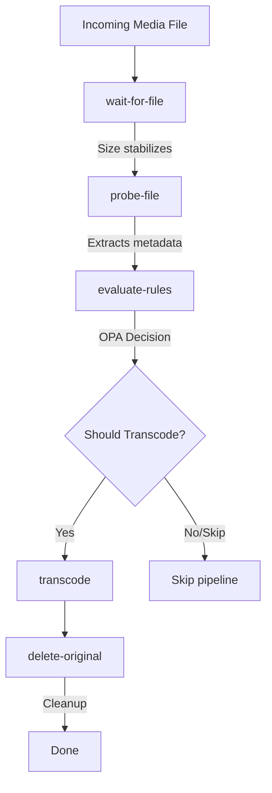

# Media Transcoder Workflow

This directory contains the automated media transcoding pipeline running inside Kubernetes. It orchestrates file probing, rule evaluation via Open Policy Agent (OPA), GPU-accelerated video transcoding, and cleanup.

______________________________________________________________________

## 🎥 Architecture & Workflow

The pipeline is built on **Argo Workflows** (`WorkflowTemplate`) and follows a Directed Acyclic Graph (DAG) pattern:



### Workflow Steps:

1. **`wait-for-file`**: Enforces a 30-second stabilization window (checking file size across 3 consecutive 10-second intervals) and forces NFS/SMB client metadata cache invalidation (`touch -c`) to ensure the file copy is completely finished.
1. **`probe-file`**: Runs `ffprobe` on the input media to output structural JSON metadata containing codec, size, height, width, bitrate, and BPP (Bits Per Pixel).
1. **`evaluate-rules`**: Invokes the **Open Policy Agent (OPA)** engine (using `policy/policy.rego`) to make a declarative decision on whether the file needs transcoding.
1. **`transcode`**: Runs **FFmpeg** (using VAAPI hardware acceleration) to convert the video to highly-compatible formats at the desired quality tier if the policy dictates it.
1. **`delete-original`**: Safely cleans up the input file after ensuring the output is valid and not overwriting itself.

______________________________________________________________________

## 🛡️ OPA Transcoding Policy (`policy/policy.rego`)

The rule engine makes decisions based on the following criteria:

- **Skip Conditions**: Avoids transcoding if the file is already encoded using an efficient codec (`hevc`, `h265`, `av1`, `vp9`) or if the file is too small (under 50 MB).
- **Resolution Eligibility**: Matches the video against specific resolution tiers (4K, 1080P, 720P, SD) and triggers a transcode if the bitrate or BPP is higher than defined targets (meaning the file is bloated/inefficiently encoded):
  - **4K**: `bpp >= 0.03` or `bitrate >= 10M`
  - **1080P**: `bpp >= 0.04` or `bitrate >= 4M`
  - **720P**: `bpp >= 0.05` or `bitrate >= 2M`
  - **SD**: `bpp >= 0.08` or `bitrate >= 1.5M`

______________________________________________________________________

## 🧪 Testing the Policy

Testing is fully automated and written in `policy/policy_test.rego`.

### Running Tests Locally

Because standard OPA container images do not package a shell, we use the official `-debug` image variant to run tests and verification scripts.

#### 🐳 Using Colima (macOS standard)

If you are developing on macOS using Colima as your container runtime, run:

```bash
docker --context colima run --rm \
  -v $(pwd)/policy:/policy \
  openpolicyagent/opa:1.16.2-debug test /policy/ -v
```

#### 🐳 Using Standard Docker (Linux / standard setup)

For regular Docker daemon installations:

```bash
docker run --rm \
  -v $(pwd)/policy:/policy \
  openpolicyagent/opa:1.16.2-debug test /policy/ -v
```

______________________________________________________________________

## 📁 Directory Structure

- `workflow-template.yaml` — Argo Workflow pipeline definition.
- `policy/` — Rego rules and test suites.
  - `policy.rego` — OPA decision rules.
  - `policy_test.rego` — Declarative regression tests.
- `scripts/` — Helper scripts running inside the pipeline.
  - `transcode.sh` — FFmpeg transcoding logic.
